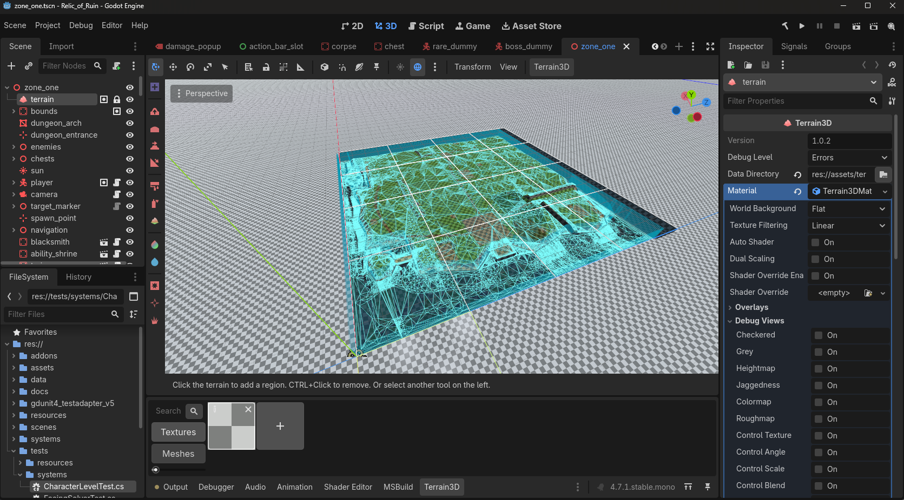

I am building a game. It is called Relic of Ruin, it is a single-player 3D RPG in
Godot 4 and C#, and this is the first entry of what I intend to be a running
record of it. There is a [project page](/projects/relic-of-ruin) describing what
the game is; this series is about how it gets there, including the parts that go
wrong.

## The thing I am actually chasing

Not a genre. A feel.

Classic vanilla World of Warcraft combat: slow, weighty, resource-starved.
Swings take time. Rage is scarce. A two-handed crit lands like a truck because
you waited for it. Modern action games have gone the other way, towards speed and
constant input, and that is a fine thing to want, but it is not this. The mood I
want sits closer to Diablo 2. Dark, grim, and loot as the reason to keep going.

That is a hard thing to specify in a ticket, which is exactly why it had to be
tested first.

## The first thing I built was a question

The riskiest unknown in the whole project was not the loot system or the save
system. Those are known problems with known shapes. The risk was this: nobody has
really proven that vanilla-style **manual-facing melee** feels good from a fixed
top-down camera.

Vanilla WoW is tab-target, which means you pick an enemy and your abilities
resolve against it with nothing to aim. But it also requires you to be facing
your target, and you play it from behind the character where facing is obvious.
Move the camera up and angle it, lock it so it never rotates, and suddenly it is
much less obvious where "forward" is. Manual facing could easily feel like
fighting the controls.

So the first milestone existed only to answer that. Grey boxes. No loot, no
menus, no zone, no art. Just a character, a dummy, and the facing rules: an
ability needs the target in range, inside a 140 degree cone, and in line of
sight, and on failure it says which of the three you missed rather than quietly
spinning you around.

Then I stopped and played it, and made myself answer honestly whether it was
fun before writing another line.

It was. That single answer is what licensed everything after it. If it had gone
the other way I would have thrown away about two weeks instead of two months.

## What a month actually produced

Since then, in 36 commits: combat with rage, a global cooldown, a hit table with
misses and dodges and parries, and crits. Loot with rarity tiers and randomly
suffixed greens. A grid inventory with bags and stacking. Levels, experience and
con colours on vanilla's curve. Death with a corpse run and durability loss. An
economy with a vendor, a blacksmith and an ability trainer. Saving that covers
gold, gear, bags, position and running cooldowns. Enemies that path, wander and
leash. One handcrafted zone, and a boss.

Then the second honest test: play the whole slice for an hour and decide whether
it holds up. It did. The only real problem I found in that hour was the loot
window lying about empty corpses, which is a bug, not a design failure.

## Three things I got wrong

**I built a spawner and then deleted it.** Placing every enemy by hand is slow, so
I built a system that populated a region from a table. It worked. I reverted it
anyway. Vanilla has no region spawner: every creature is an individually placed
point, and the reason a camp looks like a camp is that someone placed it that way.
The spawner saved typing by throwing away exactly the information that makes a
camp read as designed. The real answer is a placement tool that leaves real nodes
behind, not a runtime shortcut.

**I inferred an event from a state change.** Three separate systems worked out
"the player took damage" by watching the health number fall. Rage did it. Combat
state did it. The enemy AI did it. Then I unequipped an item with Stamina on it,
maximum health dropped, and the game granted me rage and put me in combat with
nothing attacking me. The fix was for health to emit an actual damage signal
instead of three systems guessing. That mistake is not specific to games at all,
which is why it is the one I am most likely to make again.

**I thought the hard part was code.** Systems-wise, a zone many times larger than
the current one is close to reachable. The blocker is authoring.

*Zone one in the editor, with the navigation mesh drawn over it. Everything in
that tree on the left - every enemy, chest, prop and NPC - was placed by hand.*

The zone I have is 218 nodes placed by hand, and the zone I want is thirty to
fifty times the area. That is roughly ten thousand hand-clicked nodes, and no amount of gameplay
programming makes that number smaller. So the next milestone is not a feature. It
is tooling.

## Next

Terrain that is not grey boxes, a placement tool so the world can be built without
losing my mind, and then quests, which are the largest missing system in the game
and the only thing standing between "a place with monsters in it" and "a reason to
be here".
