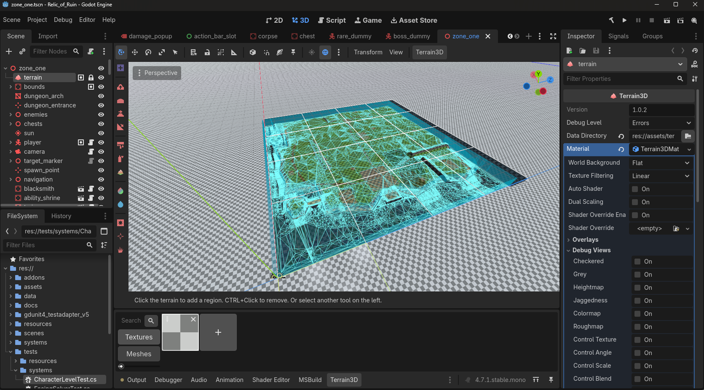

I'm building a game called Relic of Ruin. It's a single player 3D RPG in Godot 4
and C#.

This is the first entry in a running record of it. The
[project page](/projects/relic-of-ruin) describes what the game is. This series
is about how it gets there, including the parts that go wrong.

## What I'm chasing

A feel, not a genre: classic vanilla World of Warcraft combat.

- Slow, weighty and short on resources.
- Swings take time. Rage is scarce.
- A two-handed crit lands like a truck, because you waited for it.
- Modern action games went the other way, towards speed and constant input.
  That's a fine thing to want, but it isn't this.
- The mood is closer to Diablo 2. Dark, grim, and loot as the reason to keep
  going.

That's hard to describe in a ticket. That's exactly why it had to be tested
first.

## The first thing I built was a question

The loot and save systems weren't the risk. Those are known problems with known
shapes.

The risk was this: nobody has really proven that vanilla style **manual facing
melee** feels good from a fixed top down camera.

- Vanilla WoW is tab target. You pick an enemy and your abilities hit it, with
  nothing to aim.
- But you also have to face your target. And you play from behind the
  character, where facing is obvious.
- Move the camera up, angle it, and lock it so it never rotates. Suddenly it's
  much less obvious where "forward" is.
- Manual facing could easily feel like fighting the controls.

So the first milestone only existed to answer that:

- Grey boxes. No loot, no menus, no zone, no art.
- Just a character, a dummy and the facing rules.
- An ability needs the target in range, inside a 140 degree cone, and in line
  of sight.
- If one fails, it tells you which of the three you missed. It doesn't quietly
  spin you around.

Then I stopped and played it. I made myself answer honestly whether it was fun
before writing another line.

It was. That one answer is what allowed everything after it. If it had gone the
other way, I'd have thrown away about two weeks instead of two months.

## What a month produced

In 36 commits:

- Combat with rage, a global cooldown, a hit table with misses, dodges and
  parries, and crits.
- Loot with rarity tiers and randomly suffixed greens.
- A grid inventory with bags and stacking.
- Levels and experience on vanilla's curve. Enemy levels change colour by how
  tough the enemy is for you.
- Death with a corpse run and durability loss.
- An economy with a vendor, a blacksmith and an ability trainer.
- Saving that covers gold, gear, bags, position and running cooldowns.
- Enemies that path, wander and leash.
- One handcrafted zone, and a boss.

Then the second honest test: play the whole slice for an hour and decide whether
it holds up. It did. The only real problem in that hour was the loot window
lying about empty corpses. That's a bug, not a design failure.

## Three things I got wrong

**1. I built a spawner and then deleted it.**

- Placing every enemy by hand is slow. So I built a system that filled a region
  from a table.
- It worked. I reverted it anyway.
- Vanilla has no region spawner. Every creature is an individually placed point.
  A camp looks like a camp because someone placed it that way.
- The spawner saved typing by throwing away exactly the information that makes
  a camp look designed.
- The real answer is a placement tool that leaves real nodes behind, not a
  shortcut at runtime.

**2. I inferred an event from a state change.**

- Three systems worked out "the player took damage" by watching the health
  number fall: rage, combat state and the enemy AI.
- Then I unequipped an item with Stamina on it, and maximum health dropped.
- The game gave me rage and put me in combat with nothing attacking me.
- The fix: health sends an actual damage signal, instead of three systems
  guessing.
- This mistake isn't specific to games at all. That's why it's the one I'm most
  likely to make again.

**3. I thought the hard part was code.**

- Systems-wise, a zone many times larger than the current one is close to
  reachable.
- The blocker is authoring.

*Zone one in the editor, with the navigation mesh drawn over it. Everything in
the tree on the left (every enemy, chest, prop and NPC) was placed by hand.*

- The zone I have is 218 nodes placed by hand.
- The zone I want is thirty to fifty times the area. That's roughly ten thousand
  hand-clicked nodes.
- No amount of gameplay programming makes that number smaller.
- So the next milestone isn't a feature. It's tooling.

## Next

- Terrain that isn't grey boxes.
- A placement tool, so the world can be built without losing my mind.
- Then quests. They're the largest missing system in the game. They're the only
  thing between "a place with monsters in it" and "a reason to be here".
