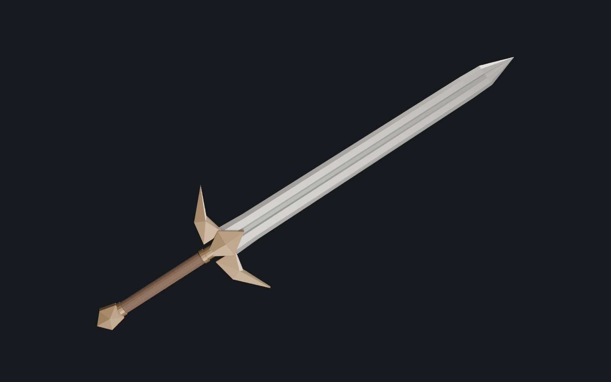
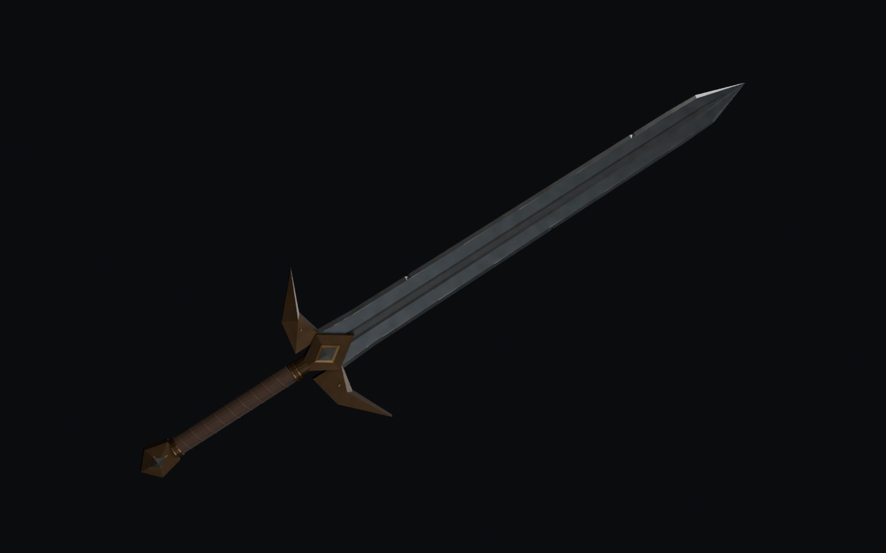
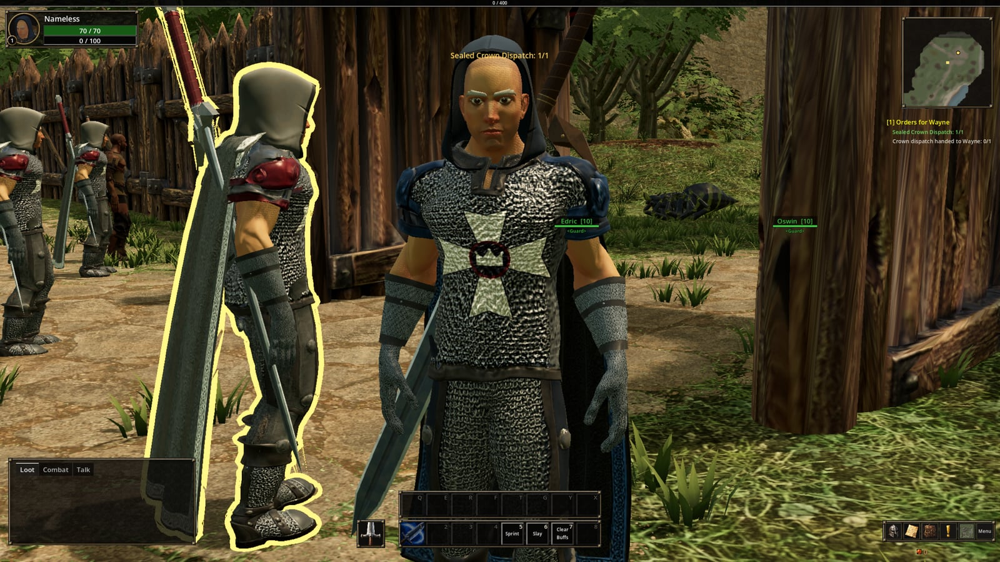

There are four swords in the game and all of them use the same mesh. The character
starts with the Notched Greatsword, which is issued to the King's Rangers. Later
the player can find a Ruined Longblade, and Smith Ordrek can mend it into the
Warden's Longblade. The guards in the camp carry the Crown Longblade, which is the
same blade with a red grip. In this post I describe how that mesh was made and
what had to be done before the character could actually hold it and hit something
with it.

## Making the sword with a script

Before this sword, the longblade slot had already been through a couple of
models. On 28 September I tried a different approach. Instead of starting from
concept images or a generator, I wrote a Python script that builds the sword
directly in Blender. Blender can be controlled completely from Python, which
means a model can be described in code as vertices, faces and materials, and the
script creates it and exports it.

The first script made a blockout, where the blade, guard, grip and pommel are
separate parts with flat placeholder colours, 906 triangles in total. I took the
measurements from the sword it was replacing, so it has the same axis along the
blade, the same origin and the same overall length of 1.92 metres. I did this so
that it could go into the existing weapon scene without anything else having to
move. The guard is 49 cm wide and the grip is 50 mm thick and about 40 cm long.

Next to the model the script also wrote a small validation file with the
triangle count, the length, the guard width, the grip diameter and whether the
exported file reads back the same as what was written. The last line in it was
`game_hand_fit_verified: false`, because at that point the sword had not been
tried in the hands yet. I never updated that file afterwards, so it still says
false.

The next morning a second script made the version that is in the game now. It
keeps the same measurements, but it has more shape, 1654 triangles, and this time
also a surface. The scratches and wear are noise patterns in Blender's material
nodes, and they are baked into three 1024 pixel textures (colour, normal, and
metal with roughness) that are packed into the file. The steel is dark and the
grip is a dark brown leather.

It went into the game on 29 September, and the commit that added it already
mentions that it had to be brightened.

## Getting it into both hands

Making the sword took one evening and one morning. Getting it to sit correctly
in the hands took longer, although most of that work had already been done for
other weapons before this sword existed.

Every weapon in the game is its own small scene with a root node, the model
under it and a marker called `sheath`. The game hangs the root on an attachment
that follows the right hand bone. In the hand the root sits exactly on that
attachment, and on the back it takes the transform of the `sheath` marker. This
means that the only thing that decides how the sword sits in the hand is the
offset of the model under the root.

The left hand is not connected to the sword in any way. The animation places the
left hand where it places it, and the handle is either there or it is not.
Because of that I did not type the offset in by hand, and it is solved by a
script instead. The script plays the two handed animations, works out where each
hand closes, finds the handle on the mesh and places the handle so that it goes
through both hands.

The first version of the script aimed at the hand bones, but in this rig those
bones sit at the wrists. The line between the wrists is 31.8 degrees off the line
between the palms, and that is why every early fit still needed fixing by hand.
The script now aims at the palms.

Finding the handle was a separate problem. One way is to cut the mesh into slices
along its length and look for the longest thin part. That works for an axe, but
on a sword the longest thin part is the blade, so a sword fitted this way would be
held by the blade and swung pommel first. Because of that the handle is now found
by its material name, and the slicing is only used when there is no such
material.

The grip size was the one thing this sword got without extra work. The fingers in
the combat idle had been posed by hand around a 50 mm handle, because the default
fist only closed around about 27 mm and the fingers went into anything thicker.
Since then every two handed weapon has a 50 mm grip, and the script that made the
longblade used that number from the start. Even so, the day after the sword went
in, I still had to move the grip about 16 cm along it.

## On the back

I set the longblade's position on the back by hand and approved it by looking at
it in the game. After that it became the reference for the other weapons. When a
new weapon goes on the back, a script reads the line along which the longblade's
handle lies and puts the new weapon's handle on the same line. Copying the
numbers directly does not work, because every model is built differently. The
first time I copied the numbers straight onto the spear, the spear ended up a
metre above the character's head.

*The Crown Longblade on a guard's back. It is the same mesh with a red grip.
Every two handed weapon is carried there when the character is not fighting.*

## The attack

The two handed attack came from an animation pack and was retargeted onto the
game's rig. In the backswing the left hand let go of the handle, so I reworked
the animation in Blender. In the new version both hands hold the grip the same
way as in the idle, the torso turns into the backswing so that the left hand can
stay on the handle, and the slash ends with the hilt low by the left thigh. After
that a script copies only the bones I changed back into the game's animation, and
checks that the bones I did not change still match the original within half a
degree. It took a lot of attempts, and the Blender file for this animation has
seventeen numbered backups.

## Armour

Not everything in the game is made with a script. The armour and the miner's pick
started as images and went through Tripo, which turns images into textured
models, and then through cleanup scripts in Blender. Armour is not attached to a
bone like a weapon is, so it has to be fitted to the body instead. The body is
posed inside the piece, the piece is pushed slightly away from the skin and gets
the same weights as the skin so that it moves with the skeleton, and the skin
under it is hidden, so that for example an elbow cannot go through a sleeve.

## In the game

When all of that is done, the item only has to point to the weapon scene and
nothing else is needed. When the player equips the longblade, it stays on the back
until a fight starts. Then it moves into both hands, the left hand stays on the
handle during the backswing, and the slash ends low by the left thigh.
