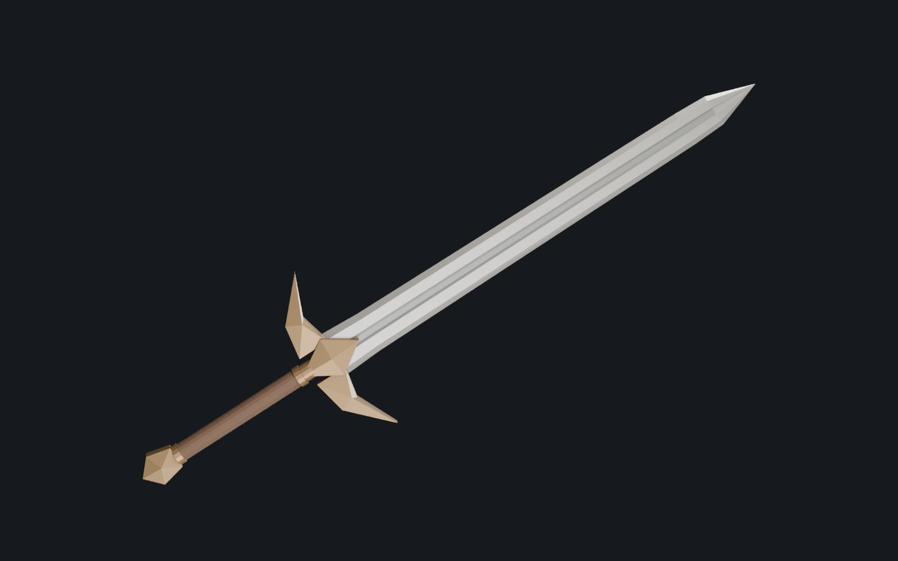
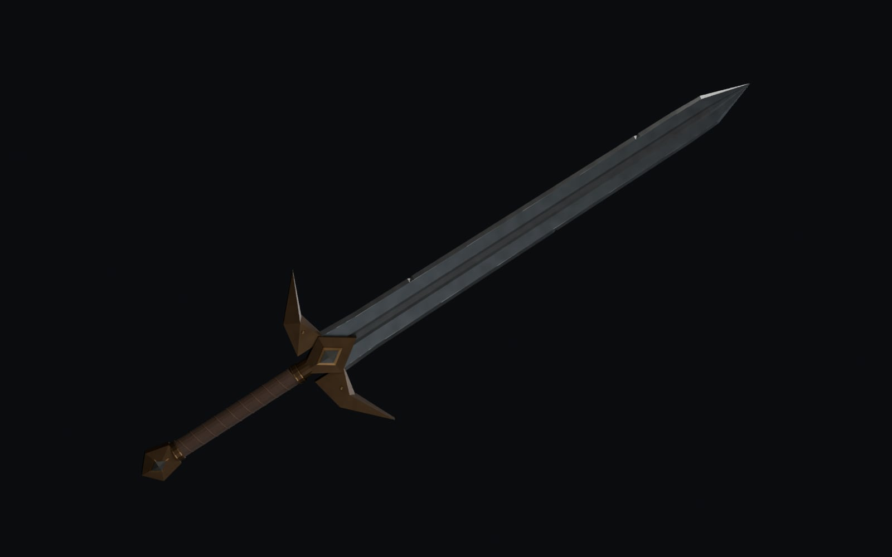
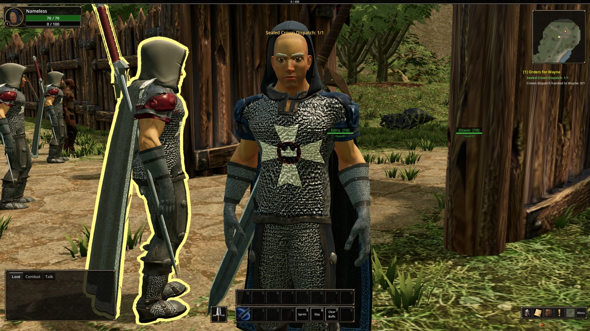

There are four swords in the game, and they all use the same mesh:

- **Notched Greatsword:** the character starts with it. It's issued to the
  King's Rangers.
- **Ruined Longblade:** the player can find it later.
- **Warden's Longblade:** Smith Ordrek can mend the Ruined Longblade into this.
- **Crown Longblade:** the guards in the camp carry it. It's the same blade with
  a red grip.

This post covers how that mesh was made, and what had to be done before the
character could actually hold it and hit something with it.

## Making the sword with a script

- Before this sword, the longblade slot had already been through a couple of
  models.
- On 28 September I tried a different approach. Instead of starting from
  concept images or a generator, I wrote a Python script that builds the sword
  directly in Blender.
- Blender can be controlled completely from Python. A model can be described in
  code as vertices, faces and materials, and the script creates it and exports
  it.

**The blockout**

- The first script made a blockout: blade, guard, grip and pommel as separate
  parts with flat placeholder colours. 906 triangles in total.
- I took the measurements from the sword it was replacing: the same axis along
  the blade, the same origin, and the same overall length of 1.92 metres.
- That way it could go into the existing weapon scene without anything else
  having to move.
- The guard is 49 cm wide. The grip is 50 mm thick and about 40 cm long.

- Next to the model, the script also wrote a small validation file. It holds the
  triangle count, the length, the guard width, the grip diameter, and whether
  the exported file reads back the same as what was written.
- The last line was `game_hand_fit_verified: false`, because the sword hadn't
  been tried in the hands yet.
- I never updated that file afterwards, so it still says false.

**The version in the game**

- The next morning, a second script made the version that's in the game now.
- It keeps the same measurements, but has more shape (1654 triangles), and a
  surface this time.
- The scratches and wear are noise patterns in Blender's material nodes.
- They're baked into three 1024 pixel textures (colour, normal, and metal with
  roughness) that are packed into the file.
- The steel is dark and the grip is dark brown leather.

It went into the game on 29 September. The commit that added it already
mentions that it had to be brightened.

## Getting it into both hands

Making the sword took one evening and one morning. Getting it to sit correctly
in the hands took longer, although most of that work had already been done for
other weapons before this sword existed.

**How weapons attach**

- Every weapon is its own small scene: a root node, the model under it, and a
  marker called `sheath`.
- The game hangs the root on an attachment that follows the right hand bone.
- In the hand, the root sits exactly on that attachment. On the back, it takes
  the transform of the `sheath` marker.
- So the only thing that decides how the sword sits in the hand is the offset
  of the model under the root.

**Fitting the left hand**

- The left hand isn't connected to the sword in any way. The animation puts the
  left hand where it puts it, and the handle is either there or it isn't.
- So I didn't type the offset in by hand. A script solves it instead.
- The script plays the two handed animations, works out where each hand closes,
  finds the handle on the mesh, and places the handle so it goes through both
  hands.
- The first version aimed at the hand bones. In this rig those bones sit at the
  wrists.
- The line between the wrists is 31.8 degrees off the line between the palms.
  That's why every early fit still needed fixing by hand. The script now aims at
  the palms.

**Finding the handle**

- One way is to cut the mesh into slices along its length and look for the
  longest thin part.
- That works for an axe. On a sword, the longest thin part is the blade. A sword
  fitted this way would be held by the blade and swung pommel first.
- So the handle is now found by its material name. The slicing is only used when
  there's no such material.

**Grip size**

- The one thing this sword got without extra work.
- The fingers in the combat idle had been posed by hand around a 50 mm handle.
  The default fist only closed around about 27 mm, and the fingers went into
  anything thicker.
- Since then, every two handed weapon has a 50 mm grip. The script that made the
  longblade used that number from the start.
- Even so, the day after the sword went in, I still had to move the grip about
  16 cm along it.

## On the back

- I set the longblade's position on the back by hand, and approved it by looking
  at it in the game.
- After that it became the reference for the other weapons.
- When a new weapon goes on the back, a script reads the line the longblade's
  handle lies along, and puts the new weapon's handle on the same line.
- Copying the numbers directly doesn't work, because every model is built
  differently. The first time I copied them straight onto the spear, the spear
  ended up a metre above the character's head.

*The Crown Longblade on a guard's back. It's the same mesh with a red grip.
Every two handed weapon is carried there when the character isn't fighting.*

## The attack

- The two handed attack came from an animation pack, and was retargeted onto
  the game's rig.
- In the backswing the left hand let go of the handle, so I reworked the
  animation in Blender.
- In the new version, both hands hold the grip the same way as in the idle. The
  torso turns into the backswing so the left hand can stay on the handle. The
  slash ends with the hilt low by the left thigh.
- A script then copies only the bones I changed back into the game's animation.
  It checks that the bones I didn't change still match the original within half
  a degree.
- It took a lot of attempts. The Blender file for this animation has seventeen
  numbered backups.

## Armour

Not everything in the game is made with a script.

- The armour and the miner's pick started as images.
- They went through Tripo, which turns images into textured models, and then
  through cleanup scripts in Blender.
- Armour isn't attached to a bone like a weapon is. It has to be fitted to the
  body instead:
  - The body is posed inside the piece.
  - The piece is pushed slightly away from the skin.
  - It gets the same weights as the skin, so it moves with the skeleton.
  - The skin under it is hidden, so an elbow can't go through a sleeve, for
    example.

## In the game

Once all that is done, the item only has to point to the weapon scene. Nothing
else is needed.

When the player equips the longblade:

- It stays on the back until a fight starts.
- Then it moves into both hands.
- The left hand stays on the handle during the backswing.
- The slash ends low by the left thigh.
