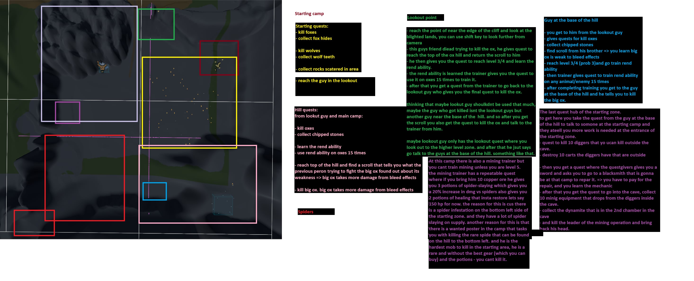
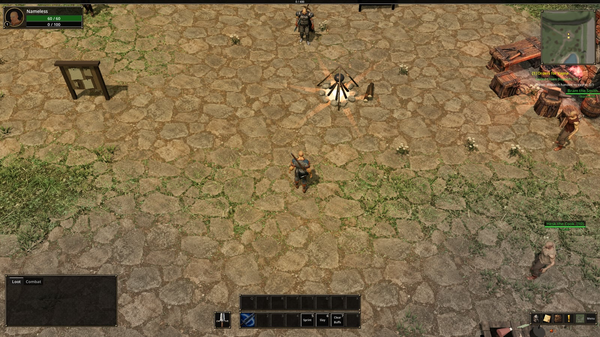
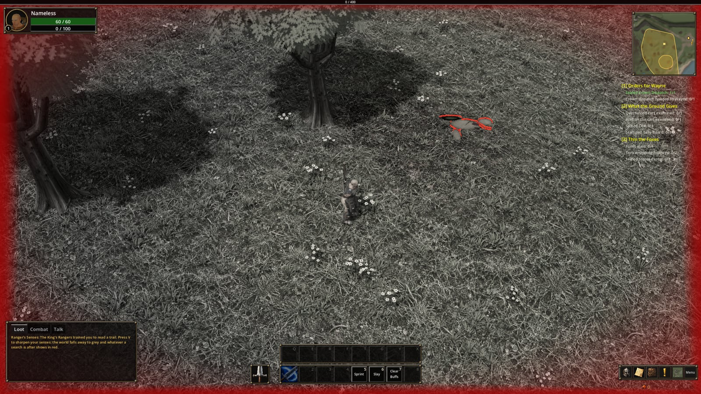
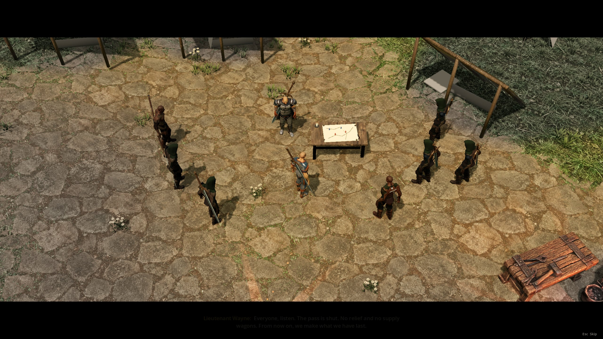

The game has 50 quests at the moment. At the start I planned them on a screenshot
of the zone, where I drew coloured boxes over the areas and wrote notes next to
each box about who gives which quest and why.



Most of that plan changed. The big ox became the Great Bear and the order of the
quests moved more than once, while the diggers, their carts and the dynamite
stayed in. The part that stayed the same the whole time is the system under the
quests, and that is what I describe here.

## A quest is a file

Every quest is a Godot resource, which means a `.tres` file that only holds data
and no code. This is a real one, shortened:

```ini
Id = "thin_the_pack"
Title = "Thin the Pack"
Offer = "The wolves are coming closer to camp. Spiders have pushed them out of the woods, and hunger has done the rest. Clear six from the approaches."
Description = "Kill six wolves. The packs hunt the long grass between the camp and the river."
Completion = "Six fewer mouths at the fence."
Objectives = [ kill 6 wolves ]
RecommendedLevel = 2
Requires = [ two earlier quests ]
RewardExperience = 80
RewardCoin = 60
```

It has the text for the three moments when the player reads it (when it is
offered, while it is active and when it is handed in), the objectives, the quests
that have to be finished first, and the reward. Because of this, adding a new
quest does not need any new code.

The file does not hold the player's progress. Godot loads a resource once and
shares it, so if "6 of 6 wolves" was saved on the quest itself, it would be the
same for every character. The progress is therefore kept in a quest log on the
character and saved together with the character. The log has two parts. The
first holds the active quests, whose counters change all the time. The second
holds the finished quests, which do not change anymore and are mostly there to
answer whether the player has already done a certain quest, which every quest
with a prerequisite has to check.

The save stores quests by an `Id` that I type by hand, and not by the file name.
I did it this way so that moving a quest file to another folder cannot delete
anyone's progress on that quest.

## Objectives

There are thirteen types of objectives: kill, collect, use something in the
world, carry something somewhere, go somewhere, reach a level, learn an ability,
use an ability, reach a skill, catch a fish, repair something, turn the camera,
and a flag that the story sets when something happens, for example when the road
opens. The camera objective is used by only one quest, at a cliff, because that
is the one place in the valley where the point is to look around. Every type is a
separate small class, and a quest only holds a list of objectives without knowing
which types they are, so adding a new type means adding one new file.

The most important difference is between kills and collects, because they count
progress in opposite ways. A kill happens once and nothing in the world remembers
it afterwards, so the kill is pushed into the quest log at the moment it happens.
A collect works the other way. The objective asks the bags how many wolf teeth the
player has every time it needs the number. I chose this because the bags are the
only count that stays correct when the player sells the teeth, splits the stack or
leaves them in a corpse.

Reading the count from the bags had one side effect I did not expect. When you
drag an item, it is taken out of the bag for a moment, so a stack of six reads as
6, 5 and then 6 again during one drag, and the last 6 counted as new progress. For
a while the game announced "Blasting Charges: 4/4" every time I sorted my bags. I
fixed it so that the announcement only shows when the count is higher than the
highest it has been on that quest.

Kill objectives can also be ordered, so that one only starts counting when the
ones before it are done. Collects cannot be ordered, because the bag count is
always true and ordering it would only hide what the player is carrying. Some
objectives are clues, like the scraps of torn wrapping in the screenshot further
down, which lead to something later in the quest. A clue counts as done as soon as
the thing after it is done, so a player who finds the end first does not have to
go back and follow the trail. A quest can also have no objectives at all, which
means the player only has to go and talk to someone, and the quest is ready to
hand in as soon as it is accepted.

## Chains, levels and hand ins

Every quest has a list of quests that have to be finished before it is offered. I
put this list on the quest that needs it and not on the earlier quest, so two
quests can depend on the same earlier quest without either of them knowing about
the other. In practice this means that when the player hands in one quest, two
new quests can appear at two different people.

A quest has two level numbers. The first decides when the quest is offered, and
the second shows the level at which the fight is fair and only changes the colour
of the quest in the log. This way a bounty can appear on the board before its
target is a fair fight for the player. The player can still accept it early, and
it will show orange in the log.

The person who takes the quest back is also a field on the quest. Most quests go
back to the person who gave them, but deliveries end at someone else, and the
person who gave you the parcel has no further dialogue for it. Repeatable quests,
for example the camp always needing more copper ore, pay very little on purpose.
If a repeatable quest paid more than the normal quests in the zone, the best way
to play would be to stand at the board and do only that.



*The camp. Hesk the cook is in the bottom right. His quest, Camp Supper, needs
two other people: Steward Alder, who is looking for a stores parcel that went
missing, and Wendel Tench at the lake, who packs a bundle of fish.*

## Finding quests

The marks above NPCs work the same as in vanilla WoW. A gold ! is a quest the
player can accept, a silver ! is a quest the player is not high enough level for
yet, a silver ? is a quest the player is on, and a gold ? is a quest that is
finished and waiting to be handed in. With these four marks the player can see in
the camp who has something for them without talking to everyone.

The tracker under the minimap shows up to ten quests. In the save it stores the
quests the player has hidden, and not the quests that are tracked. The reason is
that a newly accepted quest is then always tracked, even when an older save is
loaded that does not have that quest yet.

Then there are the senses. When the player presses V, the world turns grey and
the things the active quests need are outlined in red, for example a cart to
examine, a trail or a school of fish. Items that have to be picked up only start
to glint once the player is on the quest that needs them, so the zone is not full
of glinting items for quests the player has not accepted.



*Senses turned on. The red outline is a torn wrapping that Thin the Foxes asks the
player to follow. On the right the tracker shows three quests.*

## Making 50 quests

Filling in 50 quests by hand in the Godot editor would take a long time, so I made
the last big group of quests with a script. The script holds the text, objectives
and rewards of every quest in one place and writes the `.tres` files from that. If
a quest file already exists, the script loads it and only changes the fields it
knows about, so the changes I made by hand in the editor are kept. It also saves
all the new quests empty first and only then fills them in, which means quests can
point to each other as prerequisites no matter in which order they are written.

## Rewriting the story with existing saves

After that I rewrote the story. It is now about the Weaver and one valley closed
in by walls, with an opening outside the south gate, a briefing at the command
table and the gate closing behind the player.



The bigger problem was the saves made before the rewrite, because their quest
logs contained progress through a story that is not in the game anymore. I solved
this with a revision number. The story has one and every quest has one too. When a
save from an older version of the story is loaded, its story progress is removed,
the opening plays again and the quest log starts from the beginning. Gear, coin,
experience, skills and abilities are kept, so the player plays the new story with
the character they already built.

Quests also cannot simply be deleted, because old saves have their ids stored. For
that reason the five quests that the rewrite removed are still in the game, but
only as records that point old saves to the quests that replaced them. In total
there are 55 quest files, 50 that can be played and 5 that exist for older saves.
