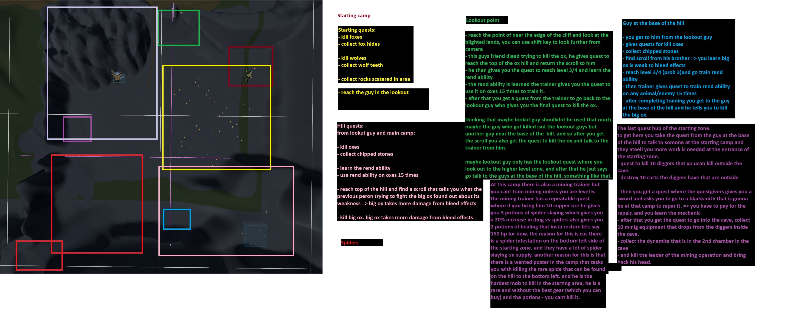
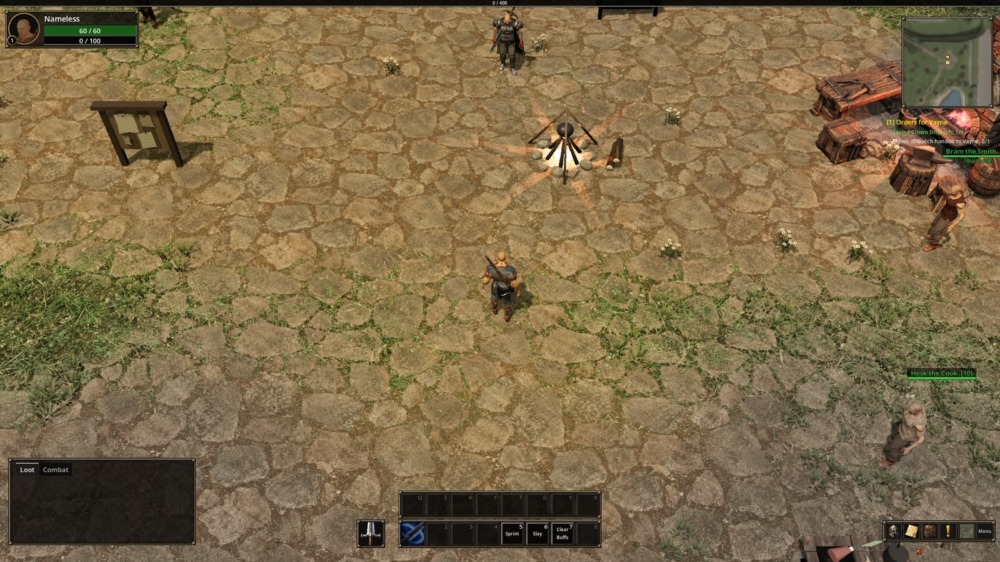
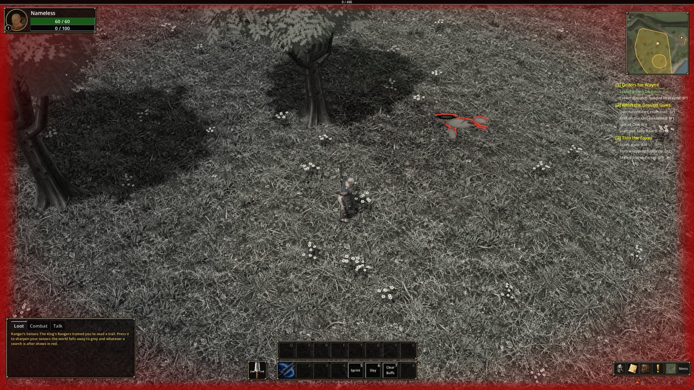
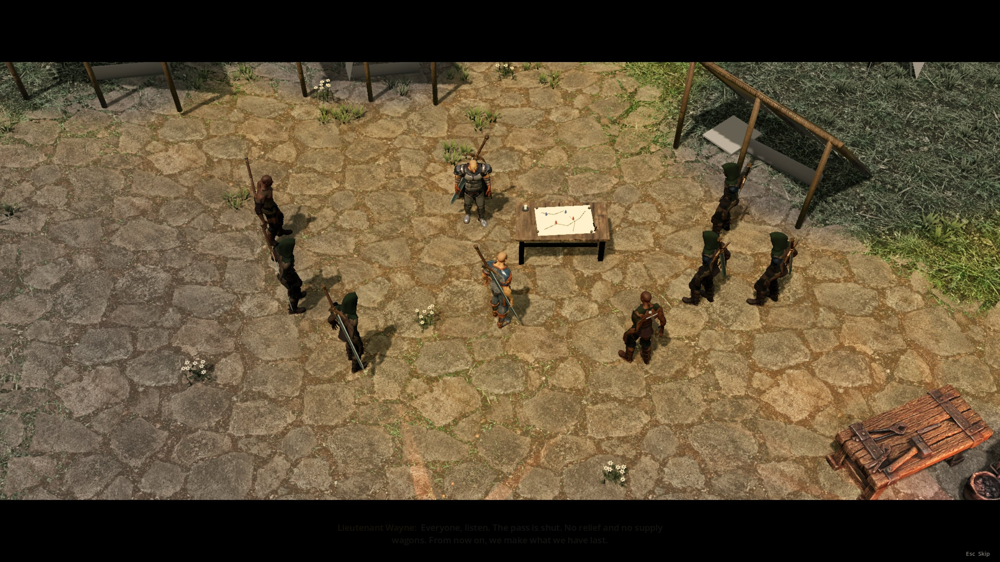

The game has 50 quests at the moment. At the start I planned them on a
screenshot of the zone. I drew coloured boxes over the areas and wrote notes next
to each box about who gives which quest and why.



Most of that plan changed:

- The big ox became the Great Bear.
- The order of the quests moved more than once.
- The diggers, their carts and the dynamite stayed in.

The part that stayed the same the whole time is the system under the quests.
That's what this post is about.

## A quest is a file

Every quest is a Godot resource: a `.tres` file that only holds data, and no
code. This is a real one, shortened:

```ini
Id = "thin_the_pack"
Title = "Thin the Pack"
Offer = "The wolves are coming closer to camp. Spiders have pushed them out of the woods, and hunger has done the rest. Clear six from the approaches."
Description = "Kill six wolves. The packs hunt the long grass between the camp and the river."
Completion = "Six fewer mouths at the fence."
Objectives = [ kill 6 wolves ]
RecommendedLevel = 2
Requires = [ two earlier quests ]
RewardExperience = 80
RewardCoin = 60
```

It holds:

- The text for the three moments the player reads it: when it's offered, while
  it's active, and when it's handed in.
- The objectives.
- The quests that have to be finished first.
- The reward.

So adding a new quest doesn't need any new code.

**Progress is kept on the character**

- The file doesn't hold the player's progress.
- Godot loads a resource once and shares it. If "6 of 6 wolves" was saved on the
  quest itself, it would be the same for every character.
- So progress is kept in a quest log on the character, and saved together with
  the character.
- The log has two parts:
  - **Active quests:** their counters change all the time.
  - **Finished quests:** these don't change any more. They're mostly there to
    answer whether the player has already done a certain quest, which every
    quest with a prerequisite has to check.
- The save stores quests by an `Id` that I type by hand, not by the file name.
  That way, moving a quest file to another folder can't delete anyone's progress
  on that quest.

## Objectives

There are thirteen types of objectives: kill, collect, use something in the
world, carry something somewhere, go somewhere, reach a level, learn an ability,
use an ability, reach a skill, catch a fish, repair something, turn the camera,
and a flag the story sets when something happens (for example, when the road
opens).

- The camera objective is used by only one quest, at a cliff. That's the one
  place in the valley where the point is to look around.
- Every type is a separate small class. A quest only holds a list of objectives,
  without knowing which types they are. So adding a new type means adding one
  new file.

**Kills and collects count in opposite ways**

This is the most important difference.

- A kill happens once, and nothing in the world remembers it afterwards. So the
  kill is pushed into the quest log the moment it happens.
- A collect works the other way. The objective asks the bags how many wolf teeth
  the player has, every time it needs the number.
- I chose this because the bags are the only count that stays correct when the
  player sells the teeth, splits the stack or leaves them in a corpse.

**A side effect I didn't expect**

- When you drag an item, it's taken out of the bag for a moment.
- So a stack of six reads as 6, 5 and then 6 again during one drag, and the last
  6 counted as new progress.
- For a while the game announced "Blasting Charges: 4/4" every time I sorted my
  bags.
- The fix: the announcement only shows when the count is higher than the
  highest it's been on that quest.

**Other rules**

- Kill objectives can be ordered, so one only starts counting when the ones
  before it are done.
- Collects can't be ordered. The bag count is always true, and ordering it would
  only hide what the player is carrying.
- Some objectives are clues, like the scraps of torn wrapping in the screenshot
  further down. They lead to something later in the quest.
- A clue counts as done as soon as the thing after it is done. A player who
  finds the end first doesn't have to go back and follow the trail.
- A quest can also have no objectives at all. The player only has to go and talk
  to someone, and the quest is ready to hand in as soon as it's accepted.

## Chains, levels and hand ins

**Chains**

- Every quest has a list of quests that have to be finished before it's offered.
- The list sits on the quest that needs it, not on the earlier quest. So two
  quests can depend on the same earlier quest without either one knowing about
  the other.
- In practice, handing in one quest can make two new quests appear at two
  different people.

**Levels**

- A quest has two level numbers.
- The first decides when the quest is offered.
- The second shows the level at which the fight is fair. It only changes the
  colour of the quest in the log.
- So a bounty can appear on the board before its target is a fair fight. The
  player can still accept it early, and it shows orange in the log.

**Hand ins**

- The person who takes the quest back is also a field on the quest.
- Most quests go back to whoever gave them. Deliveries end at someone else, and
  the person who gave you the parcel has no further dialogue for it.
- Repeatable quests pay very little on purpose, for example the camp always
  needing more copper ore.
- If a repeatable quest paid more than the normal quests in the zone, the best
  way to play would be to stand at the board and do only that.



*The camp. Hesk the cook is in the bottom right. His quest, Camp Supper, needs
two other people: Steward Alder, who is looking for a stores parcel that went
missing, and Wendel Tench at the lake, who packs a bundle of fish.*

## Finding quests

**Quest marks** work the same as in vanilla WoW:

- A gold **!** is a quest the player can accept.
- A silver **!** is a quest the player isn't high enough level for yet.
- A silver **?** is a quest the player is on.
- A gold **?** is a quest that's finished and waiting to be handed in.

With these four marks, the player can see who in the camp has something for
them without talking to everyone.

**The tracker**

- It sits under the minimap and shows up to ten quests.
- The save stores the quests the player has hidden, not the ones that are
  tracked.
- That way a newly accepted quest is always tracked, even when loading an older
  save that doesn't have that quest yet.

**Senses**

- When the player presses V, the world turns grey. The things the active quests
  need are outlined in red, for example a cart to examine, a trail or a school
  of fish.
- Items that have to be picked up only start to glint once the player is on the
  quest that needs them. So the zone isn't full of glinting items for quests the
  player hasn't accepted.



*Senses turned on. The red outline is a torn wrapping that Thin the Foxes asks
the player to follow. On the right, the tracker shows three quests.*

## Making 50 quests

Filling in 50 quests by hand in the Godot editor would take a long time. So I
made the last big group of quests with a script:

- It holds the text, objectives and rewards of every quest in one place, and
  writes the `.tres` files from that.
- If a quest file already exists, it loads it and only changes the fields it
  knows about. The changes I made by hand in the editor are kept.
- It saves all the new quests empty first, and only then fills them in. So
  quests can point to each other as prerequisites, no matter what order they're
  written in.

## Rewriting the story with existing saves

After that I rewrote the story. It's now about the Weaver and one valley closed
in by walls. There's an opening outside the south gate, a briefing at the
command table, and the gate closing behind the player.



**The problem: old saves**

- Saves made before the rewrite had quest logs with progress through a story
  that isn't in the game any more.

**The fix: a revision number**

- The story has one, and every quest has one too.
- When a save from an older version of the story is loaded, its story progress
  is removed. The opening plays again, and the quest log starts from the
  beginning.
- Gear, coin, experience, skills and abilities are kept. The player plays the
  new story with the character they already built.

**Quests can't simply be deleted**

- Old saves have their ids stored.
- So the five quests the rewrite removed are still in the game, but only as
  records that point old saves to the quests that replaced them.
- In total there are 55 quest files: 50 that can be played, and 5 that exist for
  older saves.
