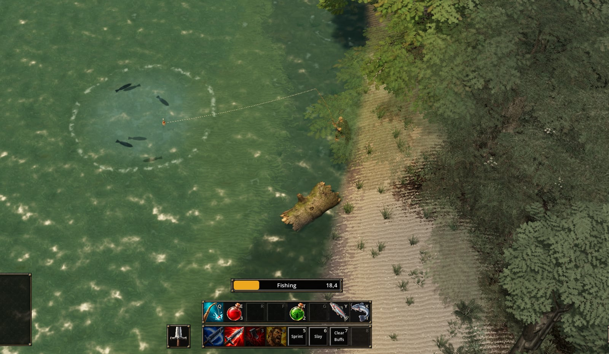
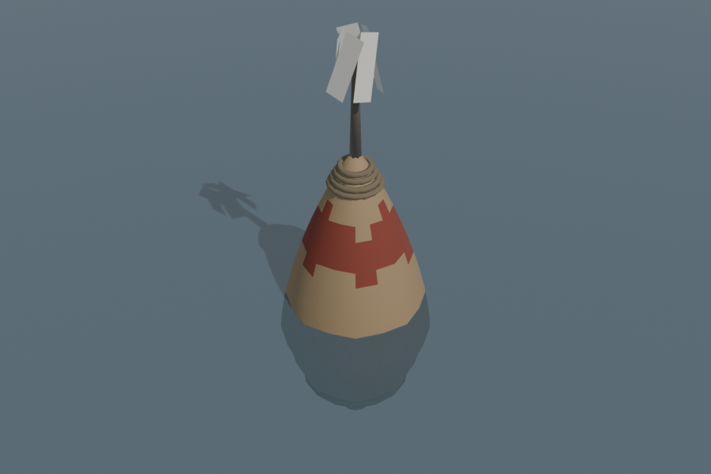
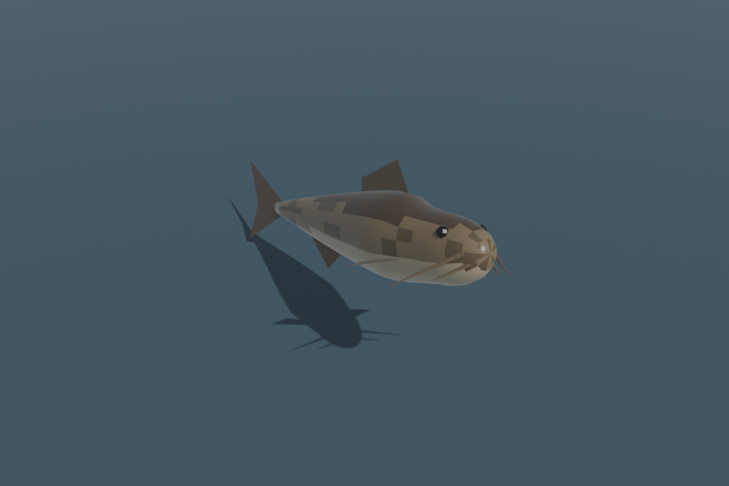
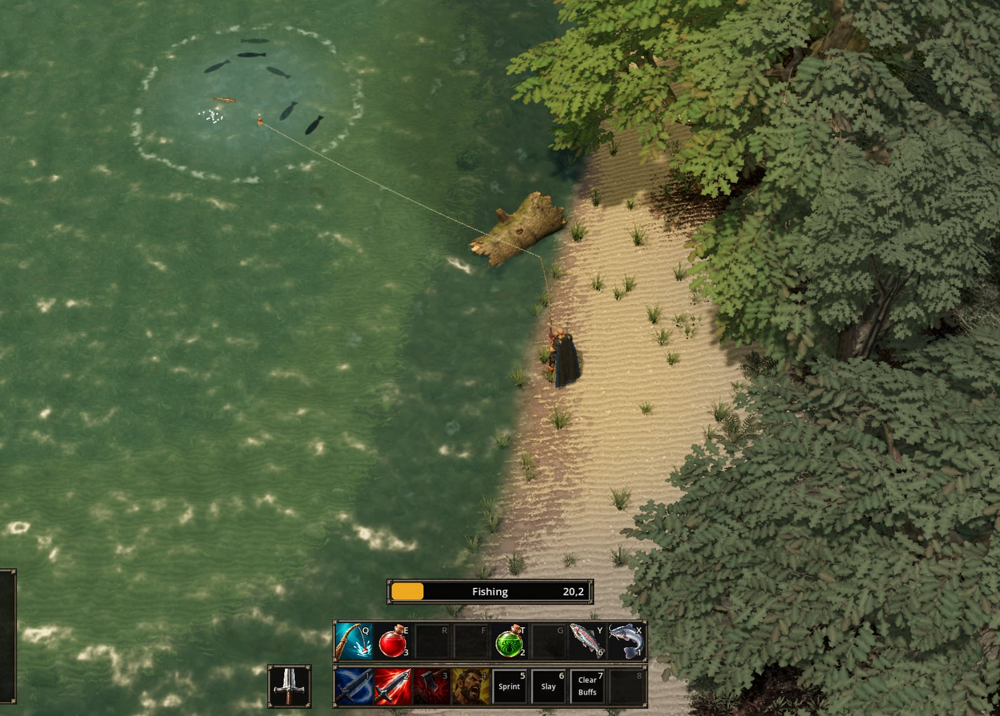
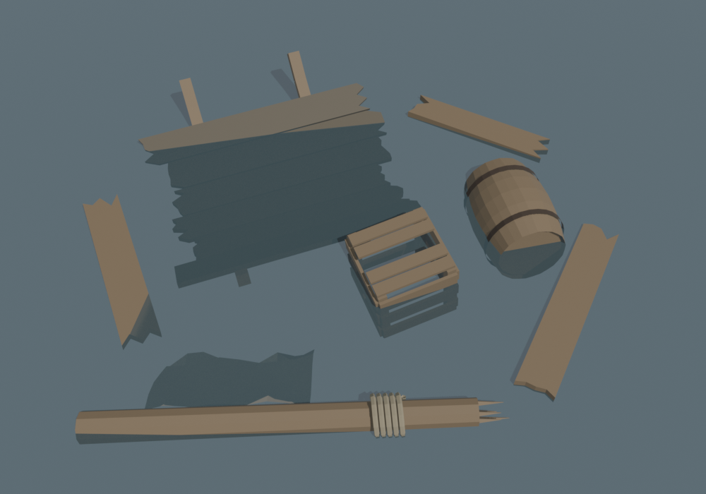
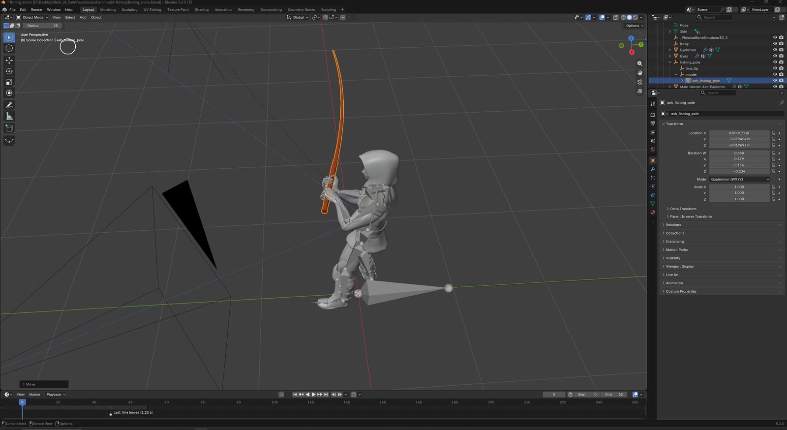

The title is how I think about fishing in RPGs. Take the combat away, and
fishing has the same loop as the rest of the game:

- You start something.
- You wait for a moment you don't control.
- You have to react inside a short window.
- Then a loot table decides what you get.

In Relic of Ruin, fishing is also connected to the rest of the game. Quests ask
for fish, fish can be eaten, and the water also gives gear.

**Wendel Tench** teaches fishing. He sits at a fire by the lake below the camp.

- In the scene file his node is still called `nat_pagle`, after the fishing
  trainer in vanilla WoW, because I never renamed it.
- He sells the fishing pole and a lure.
- His first quest, A Full Creel, asks for three mudfish and three trout. He then
  packs them for Hesk the cook.
- Hesk's own quest, Camp Supper, also needs a bundle of fish from Wendel.

## Cast, wait, strike

**The cast**

- When the player presses the fishing button, the line goes 9 metres towards
  the pointer.
- Before, it landed exactly on the pointer, anywhere between 3 and 16 metres
  away. The same button made a long cast one time and a short one the next, and
  the player couldn't tell why.
- Now every cast aims at 9 metres. It only lands a bit closer or further when
  that exact spot isn't water.
- There's also a minimum distance, so the player can't cast into the water
  they're standing in. The bobber would be inside their legs and impossible to
  click.

**The wait and the bite**

- When the bobber lands, a 22 second channel starts. In vanilla it's 30
  seconds.
- Moving or getting hit breaks it, the same as with mining.
- Somewhere between 4 and 17 seconds after the cast, the bobber splashes and
  goes under.
- From the splash, the player has 2.5 seconds to click it:
  - **In time:** the catch shows in a loot window.
  - **Too late:** the fish got away. The line stays out until the channel ends,
    but nothing else will bite.
  - **Before the splash:** there was nothing on the hook.

**Why the 2.5 second window matters**

- It's the most important number in fishing.
- Too long, and the player can look away and still make it. Too short, and
  fishing turns into a reflex test.
- Without the window, fishing would only be a cast bar to watch. With it, the
  player has to actually pay attention to the bobber.

**Making the bite easy to see**

- The bite is the only moment in the wait that asks anything of the player, so
  it has to be easy to see.
- On a bite, the bobber is pulled under quickly and stays under, without moving,
  while the fish is on. It's the same as in vanilla, where the missing bobber is
  the signal.
- I tried it with the bobber moving around under the water. It looked more like
  a broken float than a fish on the hook.

**Making the water fishable**

- The water in the zone is only a mesh with a shader. It has no collision, so a
  ray aimed at the lake went straight through it and hit the lakebed.
- So every body of water where fishing is possible has a small node under its
  mesh. It builds a collider in the exact shape of the mesh when the level
  loads.
- The collider is on its own physics layer that only fishing checks, so it
  doesn't block anything else.
- It's built from the mesh, so if I change the water meshes, the fishable area
  moves with the water.
- Water without this node can't be fished. That's on purpose: I want to decide
  which water has fish, instead of every puddle in a cave giving fish.

## What can be caught

**Open water** in the lake gives:

- a mudfish about six times out of ten
- a trout about one time in four
- a Waterlogged Boot about one time in eight

**Schools**

- Most trout come from schools. A school is a ring of fish on the water.
- If the line lands within 3.5 metres of its centre, the player fishes the
  school instead of the lake.
- A school has more trout than mudfish, and the boot only comes up about one
  time in sixteen.
- A school gives three to five catches. Then it disappears, and a new one
  appears somewhere else along the shore.
- Vanilla does it the same way. I kept it because it makes the player move along
  the shore instead of standing in one place.
- Once the player has learned fishing, pressing V for the senses outlines every
  school they can fish in red.

**Quality**

- Fish are plain, or one, two or three stars.
- I took this idea from Stardew Valley, together with its prices. A one star
  fish sells for a quarter more, and a three star fish for double.
- The chance of stars belongs to the water, not the fish. Open water gives a one
  star fish about one time in ten, and a school almost one time in five.
- The fishing skill raises these chances, up to double at skill 100.
- Every catch is still random, so even a beginner can catch a three star trout
  on the first evening.

**Eating**

- A mudfish heals 8 health per tick and a trout 12, over 12 seconds of eating.
- So going fishing between fights also works as healing.

## Wrecks

- Floating Wreckage works like a school, but the only thing it gives is a
  Tightly Sealed Box.
- One wreck gives two or three boxes before it disappears.
- When opened, a box gives coin, potions, rations, and grey, white or green
  gear. For example a mail shirt, salvaged plate, bracers, a belt, a moth eaten
  cloak or digger's mitts.
- In fishing, green items only come from these boxes, never directly from the
  hook.

- Since the playtest on 20 October, the boxes are also the only way to get money
  from fishing.
- Before that, any catch could also give between 80 and 250 copper. I removed
  that because loose coins on a fishing hook didn't make sense.

## The fishing skill

**The first version**

- It used the vanilla rule for professions: the chance to learn depends on how
  difficult the water is for the player.
- Orange always teaches, yellow and green sometimes, and grey never.
- At that time, Still Water (Wendel's second quest) asked the player to raise
  fishing to 75.

**Why it didn't work**

- All the water in this zone is beginner water. It turned grey long before 75,
  and the skill stopped rising.
- So the quest couldn't be finished. I changed it on 6 October.

**The new version**

- The skill doesn't depend on the water any more. Every catch can teach, on any
  water.
- The chance is the part of the cap the player still has to climb, raised to the
  power of 0.5.
- In practice: a point on almost every catch at the beginning, one point in nine
  catches near the top, and about 140 catches from 0 to 75.

**The lure**

- Wendel also sells a lure, the Bright Spinner. It adds 10 to fishing for ten
  minutes.
- It helps with the catch, and lets the player fish water slightly above their
  skill.
- It doesn't count for learning, so the skill can't be raised faster by buying
  lures.

**Still Water now**

- It was later rewritten together with the rest of the story.
- It now asks for one fish from each of three places: the reeds at the south end
  of the lake below the camp, the river current to the south west, and the
  stones of the lower lake.
- The reward is a Weighted Jig.
- A separate fishing spot, Stones Off the West Shore, needs a skill of 40. It has
  the Stoneskin, which sells for more than any other fish.

## The rod

**The problem**

- Until today, the fishing rod went straight through the character's fingers.
- The cast and the wait animations are cut from Mixamo takes.
- In the playtest on 20 October I closed both hands into fists. The open fingers
  from Mixamo looked like the pole was pushed through the hand.
- Even with closed fists, the hands weren't on the rod. The fists were taken
  from the polearm idle. The rod was at an angle that fit the right hand, but
  left the left hand about 8 cm away from it.

**The fix**

- Today I exported the character, both fishing animations and the rod into
  Blender. The rod was attached to the right hand the same way the game attaches
  it.
- In Blender I turned the rod about 50 degrees in the hand, and posed the
  fingers around it on one frame.
- A script then copies this grip to every frame of the cast and the wait, and
  writes the new rod position back into the game.
- To check the result, I exported the character from the game again and
  compared it with my Blender file. The finger tips are within a hundredth of a
  millimetre of where I placed them.

**Not fixed yet**

- The rod is now turned further, so its tip goes into the ground for about 0.4
  seconds at the start of the cast.
- From the game camera it's hard to see, but it's still on the list.
