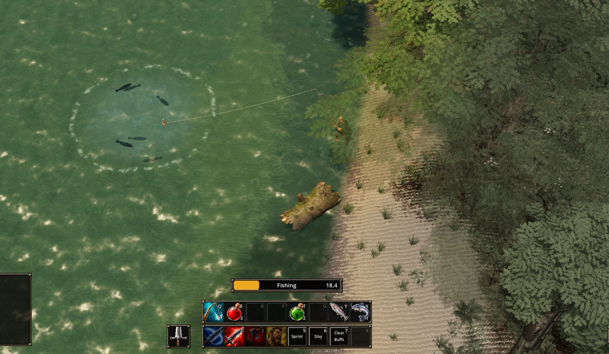
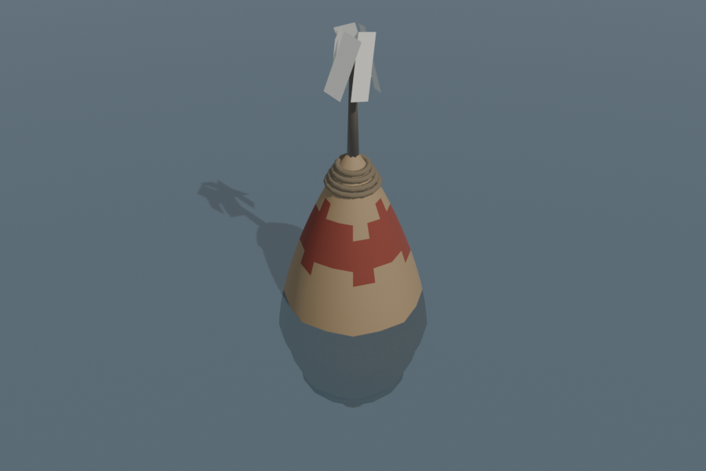
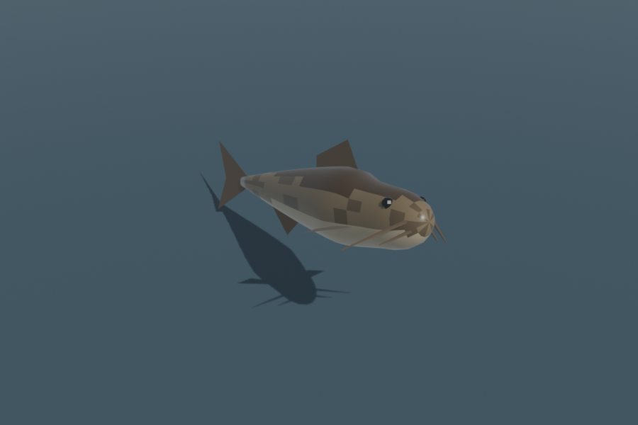
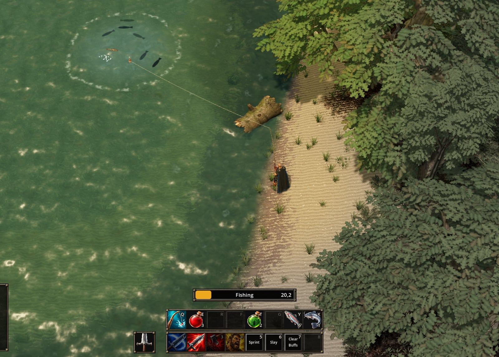
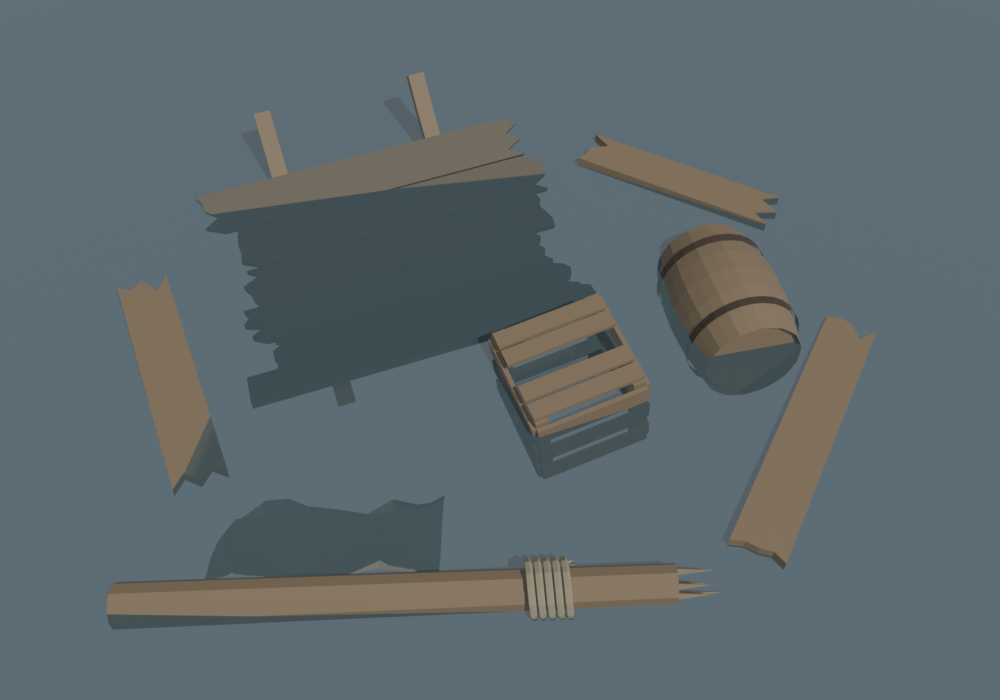
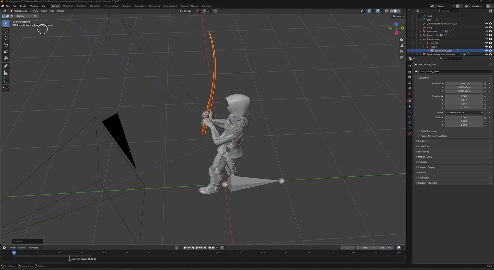

The title is how I think about fishing in RPGs. If you take the combat away,
fishing has the same loop as the rest of the game. You start something, you wait
for a moment you do not control, you have to react inside a short window, and
then a loot table decides what you get. In Relic of Ruin fishing is also connected
to the rest of the game, because quests ask for fish, fish can be eaten, and the
water also gives gear.

Fishing is taught by Wendel Tench, who sits at a fire by the lake below the camp.
In the scene file his node is still called `nat_pagle`, after the fishing trainer
in vanilla WoW, because I never renamed it. He sells the fishing pole and a lure,
and his first quest, A Full Creel, asks for three mudfish and three trout, which
he then packs for Hesk the cook. Hesk's own quest, Camp Supper, also needs a
bundle of fish from Wendel.

## Cast, wait, strike

When the player presses the fishing button, the line goes 9 metres towards the
pointer. Before, it landed exactly where the pointer was, anywhere between 3 and
16 metres away, which meant the same button made a long cast one time and a short
one the next, and the player could not tell why. Now every cast aims at 9 metres
and only lands a bit closer or further when that exact spot is not water. There is
also a minimum distance, so the player cannot cast into the water they are
standing in, because the bobber would then be inside their legs and impossible to
click.

When the bobber lands, a 22 second channel starts. In vanilla it is 30 seconds.
Moving or getting hit breaks it, the same as with mining. Somewhere between 4 and
17 seconds after the cast the bobber splashes and goes under, and from the splash
the player has 2.5 seconds to click it. If the click is in time, the catch shows
in a loot window. If it is too late, the fish got away, and the line stays out
until the channel ends, but nothing else will bite. If the click comes before the
splash, there was nothing on the hook.

The 2.5 second window is the most important number in fishing. If it is too long,
the player can look away and still make it, and if it is too short, fishing turns
into a reflex test. Without the window fishing would only be a cast bar to watch,
and with it the player has to actually pay attention to the bobber.

Because the bite is the only moment in the wait that asks anything from the
player, it has to be easy to see. On a bite the bobber is pulled under quickly and
stays under without moving while the fish is on, the same as in vanilla, where the
missing bobber is the signal. When I tried it with the bobber moving around under
the water, it looked more like a broken float than a fish on the hook.

The water caused a problem at first. The water in the zone is only a mesh with a
shader and has no collision, so a ray aimed at the lake went straight through it
and hit the lakebed. Because of this, every body of water where fishing is
possible has a small node under its mesh, which builds a collider in the exact
shape of the mesh when the level loads. The collider is on its own physics layer
that only fishing checks, so it does not block anything else. Since it is built
from the mesh, the fishable area moves with the water if I change the water
meshes. Water without this node cannot be fished, and that is on purpose, because
I want to decide which water has fish instead of every puddle in a cave giving
fish.

## What can be caught

In open water the lake gives a mudfish about six times out of ten, a trout about
one time in four, and a Waterlogged Boot about one time in eight.

Most trout come from schools. A school is a ring of fish on the water, and if the
line lands within 3.5 metres of its centre, the player fishes the school instead
of the lake. In a school there are more trout than mudfish and the boot only comes
up about one time in sixteen. A school gives three to five catches, then it
disappears and a new one appears at another place along the shore. Vanilla does it
the same way, and I kept it because it makes the player move along the shore
instead of standing in one place. When the player has learned fishing, pressing V
for the senses shows every school they can fish outlined in red.

Fish also have a quality: plain, or one, two or three stars. I took this idea from
Stardew Valley together with its prices, so a one star fish sells for a quarter
more and a three star fish for double. The chance for stars belongs to the water
and not to the fish. Open water gives a one star fish about one time in ten and a
school almost one time in five. The fishing skill raises these chances, up to
double at skill 100, but every catch is still random, so even a beginner can catch
a three star trout on the first evening.

Fish can also be eaten. A mudfish heals 8 health per tick and a trout 12, over 12
seconds of eating, so going fishing between fights also works as healing.

## Wrecks

Floating Wreckage works like a school, but the only thing it gives is a Tightly
Sealed Box. One wreck gives two or three boxes before it disappears. When opened, a
box gives coin, potions, rations and grey, white or green gear, for example a mail
shirt, salvaged plate, bracers, a belt, a moth eaten cloak or digger's mitts. In
fishing, green items only come from these boxes and never directly from the hook.

Since the playtest on 20 October the boxes are also the only way to get money from
fishing. Before that, any catch could also give between 80 and 250 copper. I
removed that because loose coins on a fishing hook did not make sense.

## The fishing skill

The first version of the fishing skill used the vanilla rule for professions,
where the chance to learn depends on how difficult the water is for the player.
Orange always teaches, yellow and green sometimes, and grey never. At that time
Still Water, Wendel's second quest, asked the player to raise fishing to 75.

This did not work, and I changed it on 6 October. All the water in this zone is
beginner water, so it turned grey long before 75 and the skill stopped rising,
which meant the quest could not be finished. Now the skill does not depend on the
water anymore. Every catch can teach, on any water, and the chance is the part of
the cap the player still has to climb, raised to the power of 0.5. In practice
this means a point on almost every catch at the beginning, one point in nine
catches near the top, and about 140 catches from 0 to 75.

Wendel also sells a lure, the Bright Spinner, which adds 10 to fishing for ten
minutes. It helps with the catch and lets the player fish water slightly above
their skill, but it does not count for learning, so the skill cannot be raised
faster by buying lures.

Still Water was later rewritten together with the rest of the story. Now it asks
for one fish from each of three places: the reeds at the south end of the lake
below the camp, the river current to the south west, and the stones of the lower
lake. The reward is a Weighted Jig. A separate fishing spot, Stones Off the West
Shore, needs a skill of 40 and has the Stoneskin, which sells for more than any
other fish.

## The rod

Until today the fishing rod went straight through the character's fingers. The
cast and the wait animations are cut from Mixamo takes. In the playtest on 20
October I closed both hands into fists, because the open fingers from Mixamo
looked like the pole was pushed through the hand. Even with closed fists the hands
were not on the rod. The fists were taken from the polearm idle, and the rod was at
an angle that fit the right hand but left the left hand about 8 cm away from it.

Today I exported the character, both fishing animations and the rod into Blender,
with the rod attached to the right hand the same way the game attaches it. In
Blender I turned the rod about 50 degrees in the hand and posed the fingers around
it on one frame. A script then copies this grip to every frame of the cast and the
wait and writes the new rod position back into the game. To check the result, I
exported the character from the game again and compared it with my Blender file,
and the finger tips are within a hundredth of a millimetre of where I placed them.

There is one side effect that I have not fixed yet. Because the rod is now turned
further, its tip goes into the ground for about 0.4 seconds at the start of the
cast. From the game camera it is hard to see, but it is still on the list.
